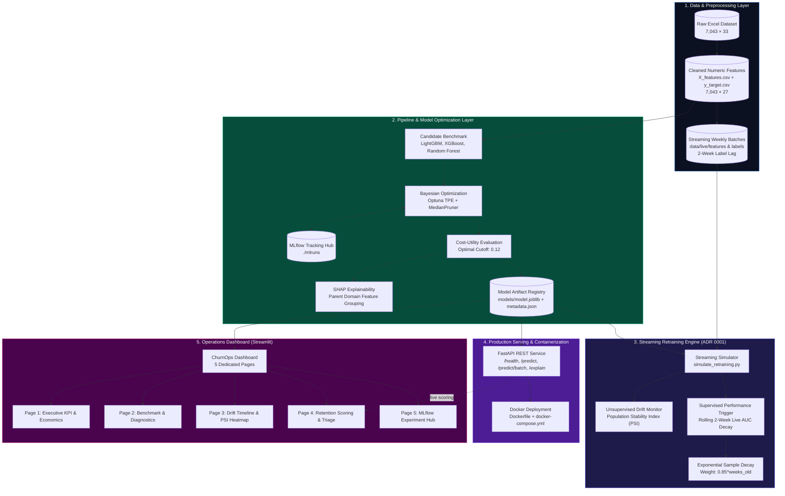

# ⚡ ChurnOps: Production Customer Churn Prediction & Automated Retraining System

[](https://www.python.org/downloads/)
[](https://github.com/astral-sh/uv)
[](https://fastapi.tiangolo.com)
[](https://streamlit.io)
[](https://mlflow.org)
[](https://www.docker.com)
[](tests/)

An enterprise-grade, closed-loop machine learning engineering system designed to detect telecom customer churn, optimize financial intervention economics, explain predictions to frontline retention specialists in real time, and continuously retrain models under covariate and concept drift.

Developed as **Project 1** for the **DEPI Machine Learning Engineering Track**.

---

## 🎯 Executive Summary & Business Economics

In subscription-based telecommunications, customer acquisition costs 5–7× more than retention. Undetected churn causes substantial financial bleeding, while untargeted retention incentives waste capital on non-churners.

ChurnOps bridges advanced data science modeling and executive financial decisioning through a calibrated **Cost-Utility Matrix**:
- **Cost of Missed Churner ($C_{\text{FN}}$)**: **$200.00** (lost future customer lifetime value).
- **Cost of Retention Incentive ($C_{\text{FP}}$)**: **$20.00** (targeted discount or service upgrade).
- **Optimal Decision Cutoff**: **`0.12`** (vs standard default `0.50`).

### 💰 Business Impact on Holdout Portfolio (1,409 Customers)

| Metric | Standard Baseline (Cutoff 0.50) | ChurnOps Optimized (Cutoff 0.12) | Business Advantage |
|---|---|---|---|
| **Holdout Churn Recall** | 48.40% (181 / 374 captured) | **93.05%** (348 / 374 captured) | **+44.65% more churners saved** |
| **Undetected Churners (FN)** | 193 missed | **26 missed** | **86.5% reduction in missed churn** |
| **Financial Loss** | $36,740.00 | **$14,880.00** | **$21,860.00 Net Savings** |
| **Business Cost Reduction** | Baseline | **-59.5%** | **Maximized Net Portfolio ROI** |

---

## 🏛️ System Architecture



---

## 🏆 Model Benchmark & Evaluation Diagnostics

All candidate tree ensembles were benchmarked across **5-Fold Stratified Cross-Validation** on 5,634 training samples:

| Rank | Model Architecture | Weighting Strategy | CV ROC-AUC (mean ± std) | CV PR-AUC (mean ± std) | Selection Status |
|:---:|---|---|:---:|:---:|:---:|
| 🥇 | **LightGBM** | Native Unweighted | **0.8528 ± 0.0104** | **0.6385 ± 0.0210** | **Best Candidate** |
| 🥈 | **XGBoost** | Native Unweighted | **0.8492 ± 0.0118** | **0.6310 ± 0.0225** | Candidate |
| 🥉 | **Random Forest** | Native Unweighted | **0.8474 ± 0.0107** | **0.6276 ± 0.0205** | Production Default |
| 4 | LightGBM | Balanced (`scale_pos_weight`) | 0.8415 ± 0.0121 | 0.6220 ± 0.0214 | Evaluated |
| 5 | XGBoost | Balanced (`scale_pos_weight`) | 0.8380 ± 0.0130 | 0.6190 ± 0.0230 | Evaluated |
| 6 | Random Forest | Balanced (`class_weight`) | 0.8350 ± 0.0115 | 0.6150 ± 0.0210 | Evaluated |

### 🔍 Interpretability & Frontline Explainability

ChurnOps decomposes 27 one-hot preprocessed features back into intuitive parent business domains using SHAP `TreeExplainer`:
- **Top Churn Risk Drivers (+)**: Month-to-month contracts, Fiber optic internet without security add-ons, Electronic check payment, Short tenure (<6 months).
- **Top Protective Factors (-)**: Long-term multi-year contracts, DSL / bundled Tech Support & Online Backup, Automatic credit card / bank transfer billing.

---

## 🔄 Streaming Retraining Pipeline (ADR 0001)

Simulates production streaming conditions over an 8-week horizon with realistic operational constraints:
- **2-Week Label Lag**: Customer churn status is confirmed only after 14 days of inactivity.
- **Covariate & Concept Drift**: Injected at Week 5 (Monthly Charges ×1.25, Tenure ×0.7, 30% label flip on high-charge retained customers).
- **Dual Triggering Architecture**:
  1. *Unsupervised PSI Monitor*: Detects feature distribution shifts (`Monthly Charges` PSI jumps from <0.04 to 4.35 at Week 5).
  2. *Supervised Decay Trigger*: Fires when rolling 2-week live AUC drops $\ge 0.05$ below the historical peak.
- **Exponential Sample Decay**: Applies recency weight $w = 0.85^{\text{weeks\_old}}$ during retraining, preventing stale data from diluting recent drift patterns.

---

## ⚡ Quickstart Guide

### 1. Prerequisites & Installation

Ensure Python 3.14+ and `uv` are installed on your machine:

```bash
# Clone repository
git clone https://github.com/Manwelws/Final-Project.git
cd "Final Project"

# Install all dependencies with uv
uv sync
```

### 2. Launch the Streamlit Operations Dashboard

The dashboard provides a unified UI spanning all 5 system pages:

```bash
# Launch via CLI subcommand
uv run churn dashboard --port 8501

# Or run directly via streamlit
uv run streamlit run src/final_project/dashboard/app.py
```
Open **`http://localhost:8501`** in your browser.

### 3. Launch the FastAPI Prediction Service

```bash
# Start FastAPI REST API with Uvicorn
uv run uvicorn final_project.serving.api:app --host 0.0.0.0 --port 8000 --reload
```
Interactive Swagger API documentation is available at **`http://localhost:8000/docs`**.

### 4. Run via Docker Compose

```bash
# Build and run containerized service
docker-compose up --build
```
The REST API will be accessible on port `8000` with automated container healthcheck probes.

### 5. Run Retraining Simulation

```bash
# Run 8-week streaming retraining pipeline
python notebooks/simulate_retraining.py
```

### 6. Run Automated Test Suite

```bash
# Run all 65 automated tests
uv run pytest
```

---

## 💻 CLI Command Reference

The `churn` console CLI provides end-to-end management of the pipeline:

```bash
# 1. Benchmark candidate models with 5-fold cross-validation
uv run churn benchmark --cv-folds 5

# 2. Train baseline model or run Bayesian optimization
uv run churn train --algorithm random_forest
uv run churn train --tune --n-trials 50 --cv-folds 5

# 3. Evaluate model on holdout set and optimize cost cutoff
uv run churn evaluate --cost-fn 200 --cost-fp 20 --report-dir reports

# 4. Generate SHAP explainability plots and importance rankings
uv run churn explain --max-samples 150 --output-dir reports/figures

# 5. Launch interactive Streamlit Operations Dashboard
uv run churn dashboard --port 8501 --host 0.0.0.0
```

---

## 🌐 REST API Endpoints

| Method | Endpoint | Description | Sample Payload |
|---|---|---|---|
| `GET` | `/health` | Service health status, model algorithm, and active cutoff | None |
| `POST` | `/predict` | Single customer prediction with risk tier | `{"Contract": "Month-to-month", "Monthly Charges": 85.0, ...}` |
| `POST` | `/predict/batch` | High-throughput batch scoring | `[{"Contract": "One year", ...}, ...]` |
| `POST` | `/explain` | Signed parent SHAP decomposition | `{"profile": {"Contract": "Month-to-month", ...}}` |

---

## 📁 Repository Structure

```
├── data/
│   ├── processed/                # Authoritative source of truth
│   │   ├── X_features.csv        # 7,043 × 27 preprocessed numeric features
│   │   ├── y_target.csv          # Churn Value binary labels (0/1)
│   │   └── Telco_customer_churn_cleaned.csv
│   ├── raw/                      # Original source Excel file
│   ├── reference/                # Reference dataset for PSI monitoring
│   ├── live/                     # Streaming weekly batches (weeks 1–8)
│   ├── drift/                    # Output drift metrics CSV
│   └── retraining/               # Retraining artifacts per week
├── models/
│   ├── model.joblib              # Serialized production model artifact
│   └── metadata.json             # Typed training & evaluation metadata
├── notebooks/
│   ├── cleaning_for_retraining.ipynb
│   └── simulate_retraining.py    # Retraining simulation runner
├── reports/                      # Holdout evaluation markdown & SHAP plots
├── specs/                        # Engineering specifications & ADRs
│   ├── implementation_plan.md    # Full project roadmap & diagrams
│   ├── milestone_2_spec.md
│   ├── milestone_3_spec.md
│   └── milestone_4_spec.md
├── src/final_project/
│   ├── cli.py                    # Unified console CLI (`churn`)
│   ├── data.py                   # Data loaders & stratified splitting
│   ├── domain/                   # CostMatrix & business domain models
│   ├── drift.py                  # PSI & streaming drift algorithms
│   ├── evaluation.py             # Evaluation & threshold optimization
│   ├── explainability.py         # SHAP TreeExplainer & parent grouping
│   ├── models.py                 # Tree ensemble factories & benchmark
│   ├── pipeline.py               # Training pipeline orchestration
│   ├── registry.py               # ModelBundle & metadata schemas
│   ├── simulation.py             # Streaming engine implementation
│   ├── tuning.py                 # Optuna & MLflow Bayesian tuning
│   ├── serving/                  # FastAPI REST service & adapters
│   └── dashboard/                # Streamlit Operations Dashboard
│       ├── app.py                # Main router & design shell
│       ├── styles.py             # Dark modern design system tokens
│       ├── state.py              # Cached loaders & KPI calculations
│       └── pages/                # 5 dedicated dashboard views
├── tests/                        # 65 automated pytest test cases
├── docker-compose.yml
├── Dockerfile
├── pyproject.toml
└── README.md
```

---

## 📄 License & Academic Integrity

Developed for educational and technical portfolio assessment within the **DEPI Machine Learning Engineering Track**. All rights reserved.
