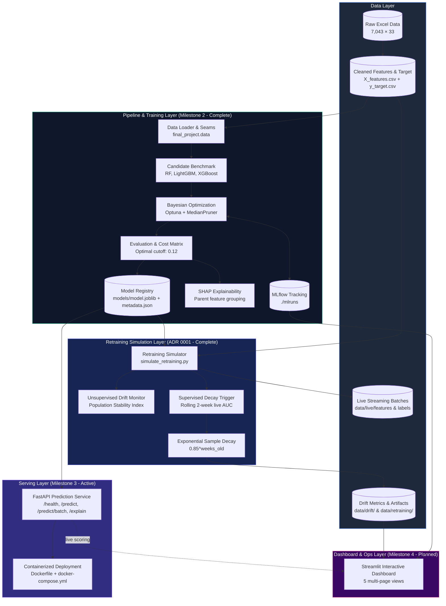
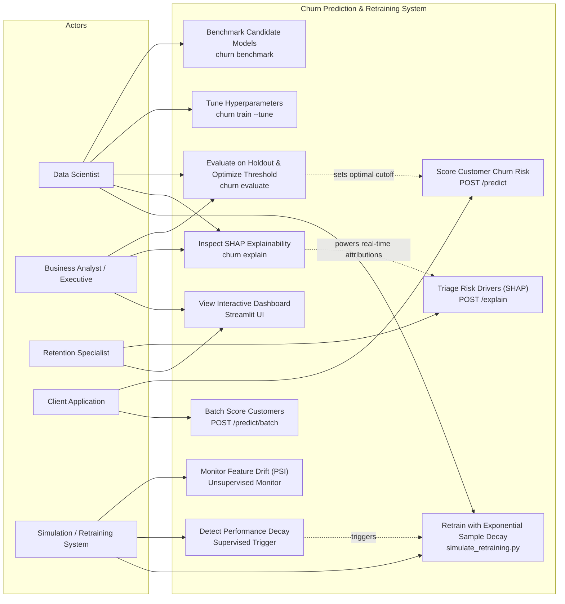
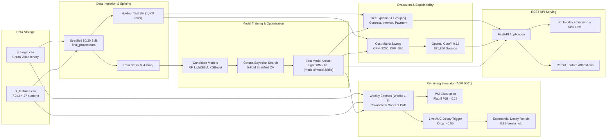
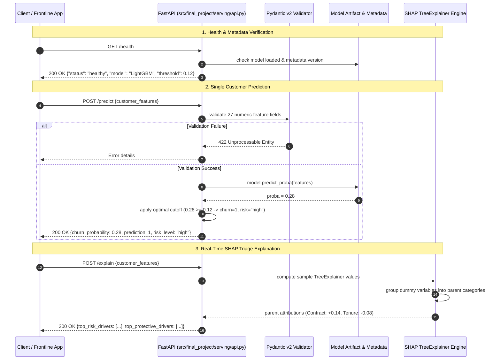
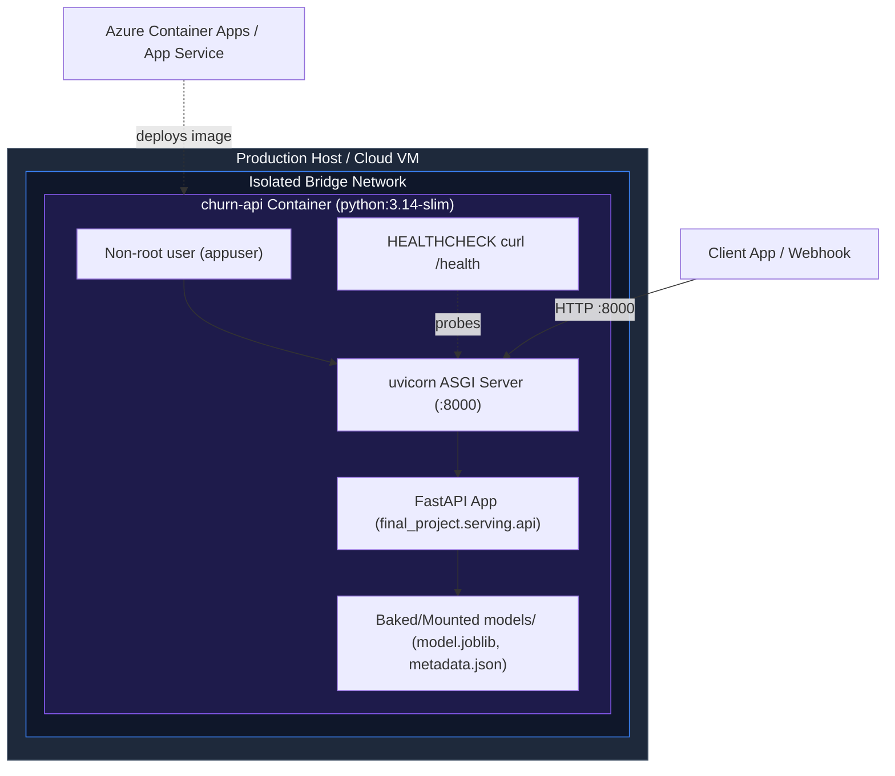
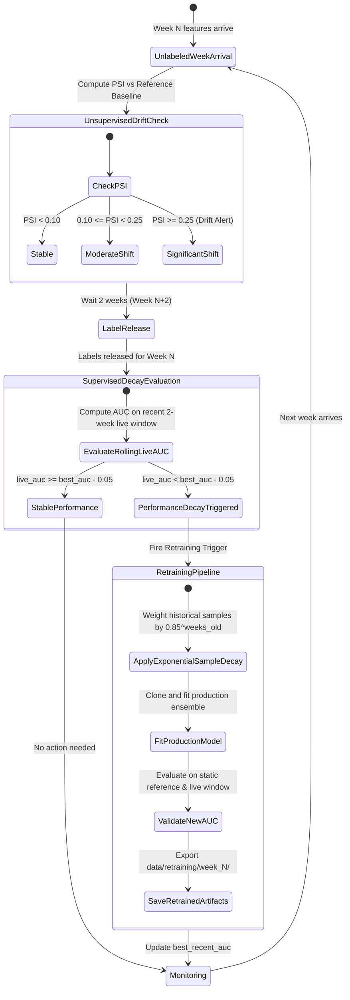
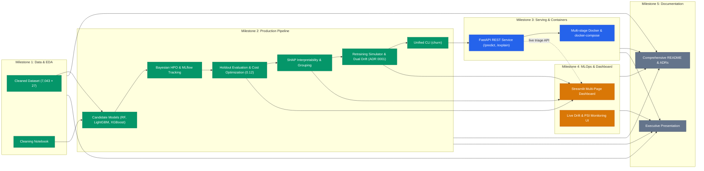

# Implementation Plan: Customer Churn Prediction & Automated Retraining System

## Goal Description

Deliver an end-to-end, production-grade Customer Churn Prediction & Automated Retraining System for **Project 1**:
- Complete data pipeline, candidate benchmarking, Bayesian hyperparameter optimization, and holdout evaluation with cost-utility threshold optimization.
- Global and individualized model interpretability using SHAP TreeExplainer with parent categorical feature grouping.
- Closed-loop retraining simulation adhering to **ADR 0001**, utilizing the production model artifact with dual drift monitoring (Unsupervised Population Stability Index [PSI] and Supervised performance decay) and exponential sample decay retraining.
- High-performance REST prediction service using **FastAPI** and **Pydantic v2**, exposing health, single prediction, batch scoring, and real-time SHAP explanation endpoints.
- Production containerization via multi-stage **Docker** and **Docker Compose**.
- Stakeholder **Streamlit** dashboard for executive KPI tracking, drift monitoring, and retention triage.
- Thorough automated testing suite and comprehensive documentation.

---

## Architectural & Design Decisions

| Dimension | Decision & Implementation | Status |
|---|---|:---:|
| **Candidate Models** | Tree-based ensembles (`RandomForestClassifier`, `LGBMClassifier`, `XGBClassifier`). LightGBM ranked #1 (ROC-AUC `0.8528 ± 0.0104`). Deep learning (PyTorch/TF) excluded per spec to avoid overfitting tabular data. | **Delivered** |
| **Class Imbalance** | Native algorithmic class weighting (`class_weight='balanced'`, `scale_pos_weight`). SMOTE excluded to avoid synthetic distortion in sparse one-hot spaces. | **Delivered** |
| **Hyperparameter Optimization** | Bayesian Optimization using **Optuna** (`TPESampler`, `MedianPruner`) across candidates, tracking parameters, metrics, and artifacts to **MLflow** (`./mlruns`). | **Delivered** |
| **Threshold Optimization** | Cost-Utility Matrix ($C_{\text{FN}}=\$200, C_{\text{FP}}=\$20$) sweep over $[0.01, 0.99]$. Optimal cutoff: **`0.12`**, reducing expected business loss by **59.5%** (**`$21,860.00`** net savings; Recall: `93.05%`). | **Delivered** |
| **Model Interpretability** | SHAP `TreeExplainer` with one-hot dummy variables aggregated into parent categories (`Contract`, `Internet Service`, `Payment Method`). Summary, beeswarm, dependence, and waterfall plots. | **Delivered** |
| **Retraining Simulation (ADR 0001)** | `notebooks/simulate_retraining.py` consumes production model artifact (`models/model.joblib`). Implemented **Unsupervised PSI** on weekly batches, **Supervised decay trigger** (rolling live AUC), and **Exponential Sample Decay** ($0.85^{\text{weeks\_old}}$). | **Delivered** |
| **Unified CLI** | Console script `churn` with subcommands: `train`, `benchmark`, `evaluate`, `explain`. | **Delivered** |
| **Serving API (Milestone 3)** | **FastAPI** with **Pydantic v2** validation. Endpoints: `GET /health`, `POST /predict`, `POST /predict/batch`, and `POST /explain` with real-time SHAP parent feature attributions. | **Active (Next)** |
| **Containerization (Milestone 3)** | Multi-stage `Dockerfile` (Python 3.14-slim, non-root user, health check probes) and `docker-compose.yml`. | **Active (Next)** |
| **Dashboard (Milestone 4)** | Multi-page **Streamlit** dashboard (Overview KPIs, Benchmark & Evaluation, Drift Timeline & PSI Heatmap, Live Prediction & Triage, MLflow Experiment Viewer). | **Planned** |

---

## System Architecture Overview



---

## Use Case Diagram



---

## Data Flow Diagram



---

## Detailed Milestone Status & Roadmap

```
Final Project/
├── data/
│   ├── processed/                      # Source of truth: X_features.csv, y_target.csv
│   ├── live/                           # Simulated streaming batches (features, labels, pending)
│   ├── reference/                      # Static pre-drift holdout baseline
│   ├── drift/drift_metrics.csv         # Simulation metrics (PSI, AUC, triggers)
│   └── retraining/week_N/              # Artifacts from simulation retraining triggers
├── models/
│   ├── model.joblib                    # Serialized production model artifact
│   └── metadata.json                   # Architecture, CV score, optimal threshold (0.12)
├── reports/
│   ├── evaluation_report.md            # Holdout evaluation markdown report
│   └── figures/                        # 5 evaluation curves + 6 SHAP visualizations
├── src/final_project/
│   ├── __init__.py                     # Public API exports
│   ├── data.py                         # Stratified data loading and splitting
│   ├── models.py                       # Candidate model factory & cross-validation
│   ├── tuning.py                       # Optuna Bayesian optimization & MLflow integration
│   ├── evaluation.py                   # Holdout evaluation, cost matrix optimization
│   ├── explainability.py               # SHAP TreeExplainer & parent feature grouping
│   ├── drift.py                        # Population Stability Index & exponential sample decay
│   ├── pipeline.py                     # High-level training orchestration
│   ├── cli.py                          # Unified churn CLI (train, benchmark, evaluate, explain)
│   ├── serving/                        # [MILESTONE 3]
│   │   ├── __init__.py
│   │   ├── api.py                      # FastAPI application
│   │   └── schemas.py                  # Pydantic v2 input/output schemas
│   └── dashboard/                      # [MILESTONE 4]
│       ├── __init__.py
│       └── app.py                      # Streamlit interactive application
├── tests/                              # Automated test suite (29 tests passing)
│   ├── test_data.py
│   ├── test_models.py
│   ├── test_candidates.py
│   ├── test_tuning.py
│   ├── test_pipeline.py
│   ├── test_pipeline_tuning.py
│   ├── test_evaluation.py
│   ├── test_evaluation_cv.py
│   ├── test_explainability.py
│   ├── test_drift_monitoring.py
│   ├── test_simulator_integration.py
│   ├── test_cli.py
│   ├── test_cli_benchmark.py
│   ├── test_cli_explain.py
│   └── test_api.py                     # [MILESTONE 3]
├── notebooks/
│   ├── cleaning_for_retraining.ipynb   # Verified data cleaning notebook
│   └── simulate_retraining.py          # ADR 0001 production retraining simulation
├── Dockerfile                          # [MILESTONE 3] Production multi-stage Dockerfile
├── docker-compose.yml                  # [MILESTONE 3] Containerized service definition
└── pyproject.toml                      # uv-managed Python project definition
```

---

### Milestone 1: Data Collection & Preprocessing — `[COMPLETED]`

- **Status**: Complete & Verified.
- **Deliverables**:
  - `data/processed/X_features.csv` (7,043 × 27, all numeric, 0 NaNs).
  - `data/processed/y_target.csv` (Churn Value, 5,174 retained / 1,869 churned).
  - Cleaning logic documented inline in `notebooks/cleaning_for_retraining.ipynb`.

---

### Milestone 2: Production Churn Modeling Pipeline, Evaluation & Explainability — `[COMPLETED]`

- **Status**: 100% Implemented & Tested (PR #10 ready for review, 29/29 tests passing).
- **Tracer Bullets Delivered**:
  1. **#2 Baseline Pipeline Tracer Bullet**: Core seams (`final_project.data`, `models`, `pipeline`), stratified 80/20 splitting, baseline Random Forest with 5-fold Stratified CV, artifact serialization, and `churn train` CLI.
  2. **#3 Multi-Model Candidates & Class Weighting**: Unified candidate factory (`RandomForestClassifier`, `LGBMClassifier`, `XGBClassifier`) with native imbalance handling (`balanced`, `scale_pos_weight`). Exposed `churn benchmark` CLI (LightGBM ranked #1 with ROC-AUC `0.8528`).
  3. **#4 Bayesian Hyperparameter Optimization & Experiment Tracking**: Optuna Bayesian search with `MedianPruner`, MLflow tracking backend (`mlruns`), and `churn train --tune`.
  4. **#5 Holdout Evaluation & Cost-Utility Thresholding**: Evaluation on unseen 20% test split ($N=1,409$). Cost matrix ($C_{\text{FN}}=\$200, C_{\text{FP}}=\$20$) optimization identified optimal decision cutoff **`0.12`**, saving **`$21,860.00`** in net business loss (59.5% reduction; Recall: `93.05%`). Exported `reports/evaluation_report.md` and 5 diagnostic plots. Exposed `churn evaluate`.
  5. **#6 Model Interpretability with SHAP**: TreeExplainer exact Shapley values. One-hot dummy features aggregated into parent categories (`Contract`, `Internet Service`, `Payment Method`). Summary, beeswarm, dependence plots, and individual waterfall plots. Exposed `churn explain`.
  6. **#7 Retraining Simulator Integration (ADR 0001)**: Replaced toy logistic regression with serialized production model artifact. Added Unsupervised Data Drift Monitor calculating **Population Stability Index (PSI)** on incoming weekly batches, and Exponential Sample Decay ($0.85^{\text{weeks\_old}}$) for adaptive retraining.

---

### Milestone 3: Production Prediction Service & Containerized Deployment — `[ACTIVE / NEXT FRONTIER]`

- **Status**: Ready for implementation.
- **Objectives**:
  - Build a high-performance REST prediction service using **FastAPI** and **Pydantic v2**.
  - Expose operational endpoints:
    - `GET /health` — service status, model architecture, metadata version.
    - `POST /predict` — single-customer scoring returning churn probability, risk category, and binary decision based on the cost-optimal cutoff (`0.12`).
    - `POST /predict/batch` — bulk scoring for tabular datasets.
    - `POST /explain` — on-demand SHAP parent feature attributions for frontline retention triage.
  - Package into a production-grade multi-stage **Dockerfile** (non-root security, health checks) and **Docker Compose**.

#### API Request/Response Sequence



#### Docker Deployment Topology



---

### Milestone 4: MLOps, Monitoring & Web Dashboard — `[PLANNED]`

- **Status**: Scheduled following Milestone 3.
- **Objectives**:
  - Multi-page interactive **Streamlit** dashboard (`src/final_project/dashboard/app.py`):
    - **Page 1: Executive KPI Overview** — dataset metrics, churn rates, financial impact of threshold optimization ($21,860 net savings).
    - **Page 2: Model Benchmark & Diagnostics** — ROC curves, PR curves, calibration diagrams, confusion matrices across candidate models.
    - **Page 3: Drift & Retraining Monitor** — live timeline of rolling AUC, Population Stability Index (PSI) heatmaps, retraining events.
    - **Page 4: Live Retention Scoring & Triage** — interactive form to input customer attributes, receive churn risk gauge, and view real-time SHAP waterfall charts.
    - **Page 5: MLflow Experiment Hub** — embedded trial parameters, loss curves, and artifact exploration.

#### Retraining Decision State Machine (ADR 0001 Verified)



---

### Milestone 5: Documentation & Presentation — `[PLANNED]`

- **Status**: Scheduled for final project wrap-up.
- **Deliverables**:
  - Comprehensive `README.md` with system diagrams, quick-start guide, and performance benchmarks.
  - Architecture Decision Records (`docs/adr/`).
  - Executive presentation slide deck summarizing methodology, financial optimization findings, and operational deployment.

---

## Milestone-to-Deliverable Traceability



*(Legend: **Green** = Completed & Verified; **Blue** = Active Frontier [Milestone 3]; **Amber** = Planned [Milestone 4]; **Slate** = Documentation [Milestone 5])*

---

## Verification Plan

### Automated Test Suite Execution

```bash
# Run complete test suite (29 existing tests + new API tests)
uv run pytest -v

# Run candidate model benchmark across 5 stratified folds
uv run churn benchmark --data-dir data/processed --cv-folds 5

# Run Bayesian hyperparameter optimization study
uv run churn train --data-dir data/processed --output-dir models --tune --n-trials 20

# Run holdout evaluation and threshold optimization
uv run churn evaluate --data-dir data/processed --model-path models/model.joblib --report-dir reports

# Run SHAP explainability generation
uv run churn explain --data-dir data/processed --model-path models/model.joblib --output-dir reports/figures

# Run retraining simulator with dual drift monitoring (ADR 0001)
uv run python notebooks/simulate_retraining.py
```

### Milestone 3 Verification (API & Container)

```bash
# 1. Run FastAPI service locally
uv run uvicorn final_project.serving.api:app --host 0.0.0.0 --port 8000 --reload

# 2. Check service health & metadata
curl -X GET http://localhost:8000/health

# 3. Test single-customer prediction (verifying optimal 0.12 cutoff application)
curl -X POST http://localhost:8000/predict \
     -H "Content-Type: application/json" \
     -d @tests/fixtures/sample_customer.json

# 4. Test real-time SHAP triage attribution
curl -X POST http://localhost:8000/explain \
     -H "Content-Type: application/json" \
     -d @tests/fixtures/sample_customer.json

# 5. Build and run Docker container
docker build -t churn-prediction-api:latest .
docker run -d -p 8000:8000 --name churn-service churn-prediction-api:latest
curl http://localhost:8000/health
docker stop churn-service && docker rm churn-service
```
